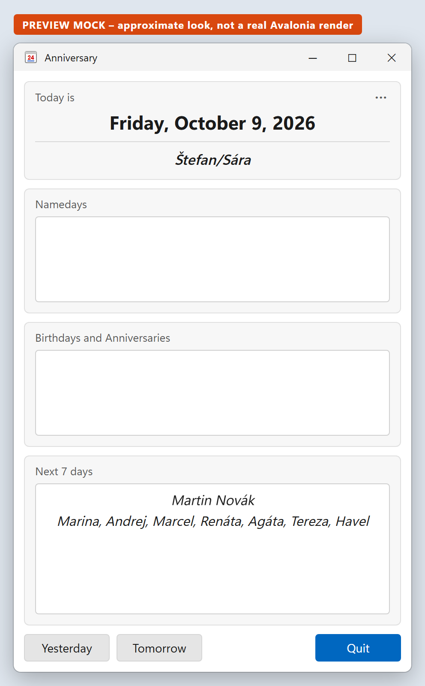
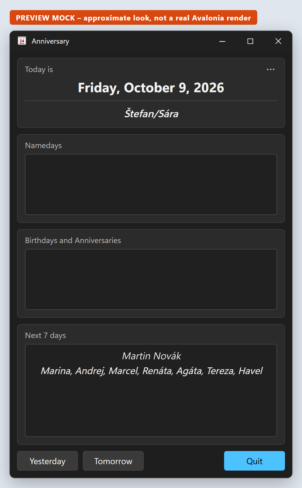
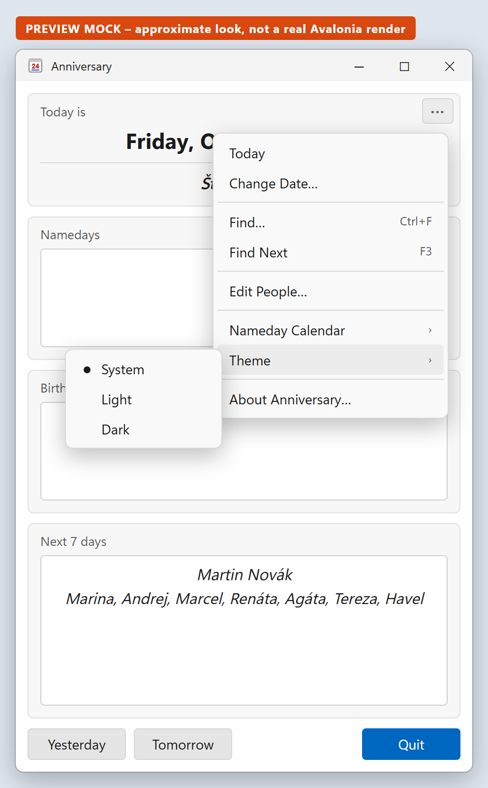
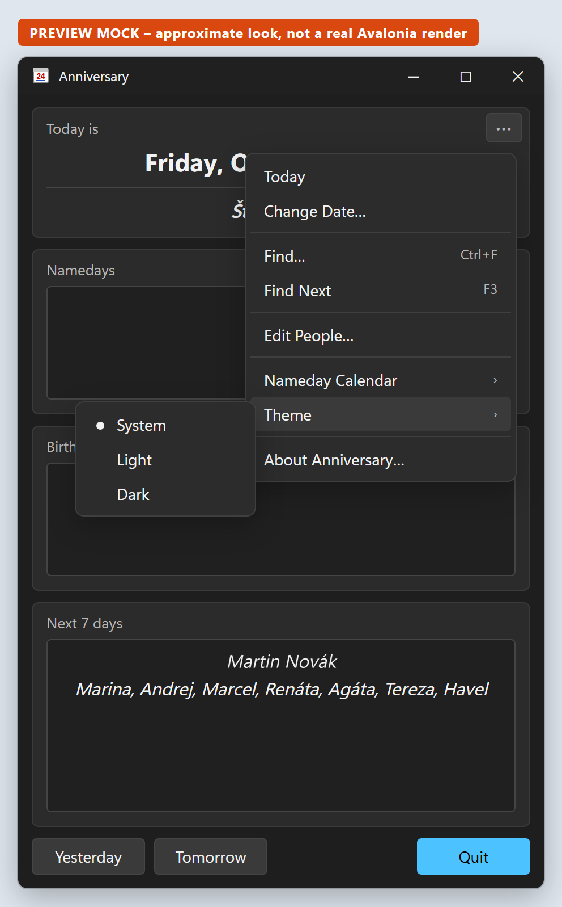

# Anniversary v5 – Specification

Status: **Phase 1 (desktop) implemented**, verified on Windows, macOS and Linux. Target folder: the root of the `anniversary` repository (originally `Tools\csharp\Anniversary.v5` in the `pokluda` repository).

This spec guides the implementation of Anniversary v5: a cross-platform rewrite of the WinForms v4 app
(`Tools\csharp\Anniversary.v4` in the `pokluda` repository; not part of this repository) using **Avalonia UI**. Unless a section says otherwise, **v5 behaves exactly like v4**.
All intended differences are listed in [Deliberate changes from v4](#11-deliberate-changes-from-v4).

---

## 1. Goals and scope

| | |
|---|---|
| **Goal** | Same small "what's today" app (namedays, birthdays, anniversaries) running natively on multiple OSes. |
| **Platform priority** | Windows → macOS → Linux → iOS → Android. |
| **Phase 1 (this spec)** | Desktop: Windows (x64 + arm64), macOS (arm64 + x64), Linux (x64 + arm64). |
| **Later phases** | iOS app project (phase 2), Android (phase 3, optional). The code structure must allow adding them without restructuring. |
| **Non-goals (phase 1)** | MSIX, code signing and notarization (the packages in 10 are unsigned, the macOS app ad-hoc signed), trimming/AOT, localization of UI strings. |

## 2. Technology

| Item | Choice |
|---|---|
| Runtime | .NET 10 (`net10.0`) |
| UI | Avalonia **12.1.x** (latest 12.1 patch at implementation time), `FluentTheme` |
| Packages (shared lib) | `Avalonia`, `Avalonia.Themes.Fluent`; `Avalonia.Controls.DataGrid` (12.1.x, versioned separately from Avalonia; used by the editor in 7.8) |
| Packages (desktop) | `Avalonia.Desktop` |
| Packages (tests) | `xunit.v3`, `xunit.runner.visualstudio`, `Microsoft.NET.Test.Sdk` (no mocking library) |
| JSON | `System.Text.Json` |
| IDE | Any; JetBrains Rider + AvaloniaRider plugin recommended (XAML preview). |

No other packages. In particular: **no** CommunityToolkit.Mvvm/ReactiveUI, **no** DI container, **no** mocking library.

## 3. Coding guidelines

1. **Honor the v4 coding style.** The repo has no `.editorconfig`, so v4 is the reference:
   - Allman braces, 4-space indentation, braces on every `if`/`else`/`foreach`/`while`, one statement per line.
   - Private fields `_camelCase`; types, methods and properties PascalCase; command handlers named `On…` (e.g. `OnFindNext`).
   - `string.Empty`, target-typed `new()`, `var` where the type is obvious, nullable reference types enabled, implicit usings.
   - File-scoped namespaces (as in v4's `Model\*.cs`, `ConfigurationManager.cs`).
   - Plain model classes with auto-properties and defaults.
2. **Keep it concise.** No MVVM, no service interfaces, no extra layers. Views use code-behind (like v4 forms). All
   non-UI logic lives in **one** class, `AnniversaryBook`. Introduce a new type only if it clearly removes complexity.
3. **XML documentation** (`/// <summary>`, plus `<param>`/`<returns>` where useful) on **every class, struct, record,
   interface and enum**, and on **every public member** (including public members of views and models).
   Inline comments only where the code needs clarification.
4. **Tests use the classic (Detroit) style** described by Martin Fowler ("Mocks Aren't Stubs"): use real objects and check
   results and state, not interactions. No mocking library. If a collaborator is awkward to use, write a small
   hand-written fake or test helper.

## 4. Solution layout

```
anniversary\                        (repository root)
  Anniversary.slnx
  Directory.Build.props              shared: net10.0, Nullable, ImplicitUsings, Version 5.0.0, AvaloniaVersion
  README.md                          build / run / test / publish / data file locations
  global.json                        opts `dotnet test` into Microsoft.Testing.Platform (needed for xUnit v3 on the .NET 10 SDK)
  .github\workflows\ci.yml           CI: build and test on Windows, macOS and Linux, then publish every RID (see 10)
  .github\skills\speckit-*\          Spec Kit commands for GitHub Copilot (/speckit-specify, /speckit-plan, …)
  .specify\                          Spec Kit: memory\constitution.md (the project's principles), templates, scripts
  docs\
    spec.md                          this file: the living, current-state specification
    plan.md                          approach, decisions and work breakdown
    copilot\handover.md              current state and how to continue in a new Copilot session
    screens\                         v5 PREVIEW MOCKS (approximate, not real renders) + mockup.html source
  specs\NNN-short-name\              Spec Kit feature folders, one per change (spec, plan, tasks, …); a record of
                                     each change, while this file describes the current behaviour
  icon\                              Build-Icon.ps1 (draws the icon), App.icns (macOS), App-1024.png (master), README.md
  calendars\                         name-day calendars: Anniversary.Calendar.*.json (generated by Build-Calendars.ps1),
                                     README.md (sources, checks, exclusions), THIRD-PARTY-NOTICES.md
  Anniversary.Shared\                class library shared by all platforms (Avalonia, no platform code)
    Anniversary.Shared.csproj        AssemblyName Anniversary.Shared, RootNamespace Anniversary
    App.axaml, App.axaml.cs
    AnniversaryBook.cs               the one logic class
    DayInfo.cs, CalendarInfo.cs
    Model\Person.cs, CalendarData.cs, AnniversaryData.cs, UserSettings.cs (all the settings, 5.5, with the AppTheme enum)
    Views\MainWindow.axaml(.cs), ChangeDateDialog.axaml(.cs), FindDialog.axaml(.cs), AboutDialog.axaml(.cs), MessageDialog.cs
    Views\PeopleEditorWindow.axaml(.cs), AnniversariesDialog.axaml(.cs), PersonRow.cs, AnniversaryRow.cs   (7.8 / 7.9)
    Assets\App.ico, App.png          AvaloniaResource: window/exe icon (16–256 px), About icon (256 px); generated by icon\Build-Icon.ps1
    Defaults\Anniversary.Data.json (empty, 5.1)   EmbeddedResource (built-in default)
                                     + ..\calendars\Anniversary.Calendar.*.json linked as EmbeddedResource (all shipped calendars)
                                     All embedded JSON uses LogicalName="%(Filename)%(Extension)", so a built-in default is
                                     found by its plain file name (e.g. "Anniversary.Calendar.Czech.json"), as 5.3 step 3 needs.
  Anniversary.Desktop\               WinExe for Windows/macOS/Linux
    Anniversary.Desktop.csproj       AssemblyName **Anniversary** (exe = Anniversary.exe / Anniversary), ApplicationIcon App.ico
    Program.cs
    StartAtLogin.cs                  Start at Login (7.12): Windows Run value, macOS login item, Linux autostart entry
    app.manifest                     (from the Avalonia template; Windows DPI awareness)
    README.md                        the user guide, shipped next to the executable (10)
  Anniversary.Tests\
    Anniversary.Tests.csproj
    DayTests.cs, FindTests.cs, LoadTests.cs, UserSettingsTests.cs, SaveTests.cs, CalendarTests.cs, EditorRowTests.cs,
    StartAtLoginTests.cs (also references Anniversary.Desktop)
    TempFolder.cs                    test helper: temporary folder that writes files and deletes itself
    TestFiles.cs                     test helper: writes the calendar and people JSON files and loads a book with settings for them
```

> The shared project is called **`Anniversary.Shared`**, not `Anniversary`. Otherwise its assembly would clash with
> the desktop exe, which must stay `Anniversary.exe` as in v4. This is still the agreed three-project layout.
> Later phases add `Anniversary.iOS` / `Anniversary.Android` next to `Anniversary.Desktop`.

Namespaces: `Anniversary` (App, AnniversaryBook, DayInfo), `Anniversary.Model`, `Anniversary.Views`, `Anniversary.Tests`.

## 5. Data

### 5.1 Files (v4 format; v5 adds optional calendar metadata and rule keys)

**Settings** are in `usersettings.json` (5.5). v4's `appsettings.json` is no longer read (user decision: one settings
file instead of two): its `numberOfDaysAhead` and `displayYearsOnBirthdays` are in `usersettings.json`, its `dataFile`
is the data file there, and its `calendarFile` is the calendar chosen in the app (7.10).

**Calendar file**: a name-day or holiday calendar. Keys are `MM-dd` dates (up to 366 entries including `02-29`; days
without names may be missing) or **rule keys** for dates that move from year to year (below). Values are display text
(may contain `,` or `/`, e.g. `"Štefan/Sára"`, `"Adam a Eva/Štědrý den"`). v5 adds **optional metadata** next to
`calendar`. v4-style files without it still load.

```json
{
  "name": "Czechia (Česko)",
  "locale": "cs-CZ",
  "source": "Anniversary v4 (Czech civil name-day calendar)",
  "license": "…",
  "calendar": { "01-01": "Nový rok", "01-02": "Karina", "10-09": "Štefan/Sára" }
}
```

| Field | Meaning |
|---|---|
| `name` | Display name in the calendar menu (7.10). If missing, it comes from the file name (`Anniversary.Calendar.{X}.json` → `X`). |
| `locale` | Culture code. Its region (e.g. `CZ` in `cs-CZ`) makes the calendar the default for that OS region (5.7). |
| `source`, `license` | Where the data came from and under what terms. **Required for every calendar added in v5** (see 5.7). |

#### Rule keys (floating dates)

| Key | The date in each year | Example |
|---|---|---|
| `MM-Ddd-n` | the n-th (1–4) weekday `Ddd` of month `MM`; `Ddd` is `Mon`, `Tue`, `Wed`, `Thu`, `Fri`, `Sat` or `Sun` | `11-Thu-4`: Thanksgiving |
| `MM-Ddd-last` | the last weekday `Ddd` of month `MM` | `05-Mon-last`: Memorial Day |
| `easter` | Easter Sunday (Western, Gregorian calendar) | `easter`: Easter |
| a rule followed by `+n` or `-n` | that date moved by n days (1–99) | `easter+1`: Easter Monday, `11-Thu-4+1`: Black Friday |

- Keys are case-insensitive. An offset may move the date into the previous or next year (e.g. `12-Mon-last+7`).
- `AnniversaryBook` works out the dates for the years it shows (6.3). People's `namedate` stays `MM-dd`.
- A key that is neither a valid `MM-dd` nor a rule is reported (5.4) and ignored; the other entries still load.

**Data file**: people. `birthdate` and anniversary keys are `yyyy-MM-dd`; `namedate` is `MM-dd`; all except `name` are optional.

```json
{
  "data": [
    { "name": "Jan Novák", "namedate": "06-24", "birthdate": "1980-03-14",
      "anniversaries": { "2008-06-21": "svatba", "2004-09-01": "seznámení" } }
  ]
}
```

#### Built-in defaults (`Defaults\`)

- **People (`Anniversary.Data.json`): empty.** `{ "data": [] }`. No personal names or birthdates are compiled into the
  binaries. Users add people with the editor (7.8), or copy their v4 `Anniversary.Data.json` into the user app-data folder
  (or next to the executable); the lookup order (5.3) prefers that file automatically.
- **Calendars: 12 shipped**, all in [`calendars\`](../calendars/README.md) and embedded in the app: the **US** holiday
  calendar (`"United States"`, `"en-US"`), the **International Days** calendar (`"International Days"`, no locale) and
  10 name-day calendars: Czech (the v4 calendar plus the two Easter
  holidays, Velký pátek and Velikonoční pondělí; metadata added: `"Czechia (Česko)"`, `"cs-CZ"`), Austrian, Bulgarian,
  French, Hungarian, Italian, Latvian, Polish, Russian and Slovak. The default is the calendar for the OS region (e.g.
  Czech in Czechia), otherwise the US one (5.7). Users choose another in the app (7.10), and the choice is remembered
  (5.5).
- When the people list is empty, the Birthdays and Anniversaries box shows a muted hint instead of nothing:
  *"No people yet. Use ⋯ ▸ Edit People… to add some."*

### 5.2 Model classes (`Anniversary.Model`)

Ported from v4 with XML docs:
- `UserSettings` (5.5) replaces v4's `AppConfig`.
- `Person`: `Name`, `DateOnly? Birthdate`, `string? Namedate`, `Dictionary<DateOnly, string>? Anniversaries`.
- `CalendarData`: `[JsonPropertyName("Calendar")] Dictionary<string, string> Data` (keys `MM-dd` or rule keys, 5.1), plus the optional metadata from 5.1: `string? Name`, `string? Locale`, `string? Source`, `string? License`. This was `Calendar` in v4; it was
  renamed so it doesn't clash with Avalonia's `Calendar` control.
- `AnniversaryData`: `[JsonPropertyName("Data")] List<Person> People`. This was `Model.Anniversary` in v4; it was
  renamed so it doesn't clash with the `Anniversary` namespace.

### 5.3 File lookup order

`AnniversaryBook.Load(…)` resolves **each file independently** (calendar, data). The calendar is chosen per 5.7. The
data file is `dataFile` from the settings (5.5), or `Anniversary.Data.json` if it isn't set. A full path, as Data File
▸ Open… and Save As… set it (7.11), is used as is, even when it's missing (5.4). A file name is found like this:

1. If the name is an **absolute path**, use it (and nothing else).
2. Otherwise, try `Path.Combine(folder, name)` for each folder **in order**. The first existing file wins.
3. Otherwise, use the **built-in default** embedded resource with that file name, if there is one.
4. Otherwise, report "not found" (see 5.4) and continue with empty data.

On desktop the app passes these folders (built in `App.OnFrameworkInitializationCompleted`):
1. `AppContext.BaseDirectory` (next to the executable, as in v4),
2. user app-data folder `…/Anniversary`:
   - Windows: `Environment.SpecialFolder.ApplicationData` → `%APPDATA%\Anniversary`
   - macOS: `Environment.SpecialFolder.LocalApplicationData` → `~/Library/Application Support/Anniversary`
   - Linux: `Environment.SpecialFolder.ApplicationData` → `~/.config/Anniversary`

The desktop project does **not** copy JSON files next to the executable. The built-in defaults are used unless the user
puts their own files in one of the folders above.

### 5.4 Load errors

Loading never throws and never shows UI. Problems are collected in `AnniversaryBook.Warnings`; the main window shows
each warning in a message dialog (title **"Data Error"**, or **"Configuration Error"** for settings problems) after it opens.

| Situation | Warning text | Result |
|---|---|---|
| Settings file missing | none | default settings (5.5) |
| Settings file can't be read (invalid JSON, a value of the wrong type, or an I/O error) | `Error loading configuration: {path}: {message}` + newline + `Using default settings.` | default settings, and the file isn't saved over (5.5) |
| Calendar not found | `Calendar file not found: {name}` | empty calendar |
| Calendar invalid JSON | `Error loading calendar: {message}` | empty calendar |
| Calendar keys that are neither `MM-dd` nor a rule (5.1) | `Unknown dates in {name}: {key}, {key}` (at most 5 keys, then `and {n} more`) | those entries are ignored |
| Data not found | `Data file not found: {name}` | no people. A chosen or absolute path is kept: the file is used as soon as it appears (7.11), and the editor asks before creating it (7.8) |
| Data invalid JSON | `Error loading data: {message}` | no people; the editor asks before replacing the file (7.8) |

### 5.5 Settings (`usersettings.json`)

All settings are in **one file**, `{user app-data folder}/usersettings.json`, in the same folder as 5.3 step 2 (e.g.
`%APPDATA%\Anniversary\usersettings.json`). The app writes it when a choice changes in its menus, and at start-up when
it's missing, so every setting is in the file, ready to edit. People may also edit it by hand **with the app closed**:
the app reads it at start-up, and saving a menu choice writes the values it read. Until 11 October 2026 the two
options were in a separate, hand-written `appsettings.json`; two files with overlapping keys confused even the author,
so the user chose one file (5.1).

```json
{
  "theme": "System",
  "calendar": "Anniversary.Calendar.Czech.json",
  "dataFile": "C:\\Users\\Jan\\OneDrive\\Anniversary.Data.json",
  "numberOfDaysAhead": 7,
  "displayYearsOnBirthdays": true
}
```

| Key | Set by | Default (missing or `null`) |
|---|---|---|
| `theme` | Theme menu (7.7): `System`, `Light` or `Dark` | `System` |
| `calendar` | Calendar menu (7.10): the file name of a calendar | the calendar for the OS region (5.7) |
| `dataFile` | Data File ▸ Open… or Save As… (7.11): a full path. By hand, a file name also works, found as in 5.3 | `Anniversary.Data.json`, found as in 5.3 |
| `numberOfDaysAhead` | by hand: the days in "Next N days" (int ≥ 0) | `7` |
| `displayYearsOnBirthdays` | by hand: whether birthdays and anniversaries show the years | `true` |

- `Model\UserSettings.cs`: `UserSettings` has `AppTheme Theme`, `string? Calendar`, `string? DataFile`,
  `int NumberOfDaysAhead`, `bool DisplayYearsOnBirthdays`, and the `[JsonIgnore]` properties `string FilePath` and
  `string? LoadError`. Each computer has its own settings, so a shared data file can have a different path on each one
  (e.g. on Windows and on macOS).
- `public static UserSettings Load(string filePath)` reads property names case-insensitively and allows comments and
  trailing commas. A missing file gives the defaults. A file that can't be read (invalid JSON, a value of the wrong
  type, or an I/O error) also gives the defaults, with `LoadError` set to the reason, which `AnniversaryBook.Load`
  reports (5.4). `FilePath` is always set.
- `public void Save()` writes every key (camelCase, indented) and creates the folder if needed. While `LoadError` is
  set it writes nothing, so a file with a typo isn't replaced and nothing in it (such as the data file's path) is lost;
  menu choices then apply to the current session only. If saving fails (`IOException` or
  `UnauthorizedAccessException`), it is ignored: the choice still applies for the current session.
- `public enum AppTheme { System, Light, Dark }`, serialized as a string (`JsonStringEnumConverter`), case-insensitive.

### 5.6 Saving the people file (used by the editor in 7.8)

- **Target path:** the data file in use (`AnniversaryBook.DataFilePath`): the file the people were loaded from, or the
  chosen or absolute file even when it was missing or couldn't be read (5.4). If the people came from the embedded
  default (`DataFilePath == null`), the target is `{user app-data folder}/{data file name}` (`Anniversary.Data.json`
  unless `dataFile` names another, 5.5), and the folder is created if needed.
- **Format:** the same as 5.1. `{ "data": [ … ] }` with camelCase property names, indented, UTF-8, Czech letters
  written as-is (`JavaScriptEncoder.UnsafeRelaxedJsonEscaping`), null/empty optional values omitted, dates `yyyy-MM-dd`,
  and anniversaries ordered by date. People are written **in list order**, which is the display order (6.1); sorting the
  grid in the editor doesn't reorder the file.
- **Write safely:** write to `{target}.tmp`, then replace the target, so a failure never leaves a half-written file.
- **Change tracking:** after loading or saving, the book remembers the file's last-write time and size.
  `HasDataFileChanged()` is true when the file exists and either differs, i.e. it was changed elsewhere (for example on
  another computer through a cloud drive) or it appeared after being missing. A file that is gone isn't a change.
- **Errors** (`IOException`, `UnauthorizedAccessException`, e.g. a read-only folder next to the exe) propagate to the
  editor, which shows *"Could not save the data file: {message}"* (title "Edit People") and stays open.

### 5.7 Calendars (choosing and adding)

- **Discovery:** the available calendars are all files named `Anniversary.Calendar.*.json` in the lookup folders (5.3),
  plus the embedded defaults. They are merged **by file name** with the same precedence as 5.3 (exe folder, then
  app-data, then embedded). So a user can add a calendar by dropping a file into the app-data folder, or override a
  shipped one. The list has the calendars with a `locale` (countries) first, sorted by display name, then those without
  one (International Days, or a user's file without metadata), also sorted by display name.
- **Which calendar is active:** the first that applies:
  1. `calendar` from the settings (5.5), if it is set and the file is still available. Choosing a calendar in the menu
     (7.10) saves it there.
  2. The first calendar, by display name, whose `locale` has the region of `CultureInfo.CurrentCulture` (e.g. `cs-CZ`
     or `en-CZ` → `CZ` → Czech). The OS sets that culture: the regional format on Windows, Language & Region on macOS,
     and `LANG`/`LC_ALL` on Linux. A neutral or invariant culture has no region.
  3. The US calendar.
- **Switching** reloads only the calendar (people are unchanged) and refreshes the main window. Find and Next N days
  use the new calendar right away. Errors follow 5.4 (a warning, then an empty calendar).
- **Shipped calendars and adding more:** the files in `calendars\` are generated by `calendars\Build-Calendars.ps1`
  from pinned, openly licensed sources (MIT: radoone/nameday-mcp; CC0: the Latvian State Language Centre). Each file
  records its `source` and `license`. `calendars\README.md` lists the sources, the quality checks (e.g. the Czech source
  matches v4 on 359/366 days) and what was left out and why: Croatian (damaged source data), Greek (incomplete, and
  partly tied to Easter), Swedish/Finnish (copyrighted official lists), and Lithuanian/Estonian/Danish/German/Spanish
  (no verified open source yet). To add a country, extend the script with a pinned source plus its license and
  validation. Name days are **never** typed in or made up by hand.
- **Holiday calendars** (US and International Days) list days defined by law, by the UN or by long tradition, so there
  is no list to download. Their entries are written in `Build-Calendars.ps1`, each with its source. Floating dates use
  rule keys (5.1).
  - **US:** federal holidays from 5 U.S.C. 6103(a), observances designated in 36 U.S.C. (Mother's Day, Father's Day,
    Flag Day, Patriot Day), the daylight saving time dates from 15 U.S.C. 260a, and traditional dates. Tests check the
    federal holidays against OPM's published schedules (9). Observed days off (e.g. Friday 3 July 2026 when 4 July is a
    Saturday) aren't listed.
  - **International Days:** 56 well-known days chosen from the United Nations list of international days (each with
    its UN resolution, or "UN list" where the list gives none; checked against the list as of 10 October 2026), plus
    five fun days kept by tradition: Pi Day, Star Wars Day, World Emoji Day, Talk Like a Pirate Day and International
    Beer Day (the first Friday of August). Names are the UN's, two of them shortened (International Holocaust
    Remembrance Day, International Volunteer Day). It has no `locale`, so the OS region never picks it (step 2 above).
  - The script also adds the two Czech public holidays that move with Easter, `easter-2` Velký pátek and `easter+1`
    Velikonoční pondělí (Act No. 245/2000 Coll., § 2), to the Czech calendar.
- **License notice:** `calendars\THIRD-PARTY-NOTICES.md` must ship with the app (copied next to the executable on
  publish, see 10) because the MIT license requires it.

## 6. Logic: `AnniversaryBook`

One plain, UI-free class. Suggested public surface (XML-documented):

```csharp
public sealed class AnniversaryBook
{
    public UserSettings Settings { get; }                       // the settings it was loaded with (5.5)
    public IReadOnlyList<string> Warnings { get; }

    public static AnniversaryBook Load(UserSettings settings, IReadOnlyList<string> folders);
    public static AnniversaryBook Load(string? preferredCalendar, params string[] folders); // default settings with
                                                                // that calendar (tests and the XAML previewer)
    public DayInfo GetDay(DateOnly day);
    public DateOnly? Find(string name, DateOnly from, bool wholeWordsOnly, bool calendarOnly);
}

public sealed record DayInfo(
    string CalendarNames,                 // calendar text for the day ("" if none)
    IReadOnlyList<string> Namedays,       // one entry per line
    IReadOnlyList<string> Birthdays,      // birthdays and anniversaries, one entry per line
    IReadOnlyList<string> NextDaysPeople, // people with an event in the next N days
    IReadOnlyList<string> NextDaysNames); // calendar names in the next N days
```

Internally: the calendar's `MM-dd` entries in a `Dictionary<string, string>`, its rule entries (5.1) in a list in file
order, and a `Dictionary<string, List<Person>>` index from `MM-dd` to people
(as in v4). **A person is added at most once per date key**, even if several of their events fall on the same day.

**Dates and "today".** All logic works with `DateOnly`, since it never needs a time of day. `AnniversaryBook` never reads
the clock: the caller always passes the day in. Only the UI reads "today", using `DateOnly.FromDateTime(DateTime.Today)`,
in two places: start-up and the **Today** command. `TimeProvider` is deliberately **not** used, because no logic depends
on the current time and passing the date in keeps the logic simple to test.

**Editing support** (for 7.8), also on `AnniversaryBook`:

```csharp
public IReadOnlyList<Person> People { get; }                    // in data-file order
public string? DataFilePath { get; }                            // the data file in use (5.6); null for the embedded default
public string SavePathFor();                                    // 5.6 target path rule (uses DataFilePath or AppDataFolder)
public void SavePeople(IReadOnlyList<Person> people, string path); // writes per 5.6, then replaces People and rebuilds the index
public static bool IsValidNameday(string? value);               // null/empty, or "MM-dd" valid in a leap year (allows 02-29)
```

**Data file support** (for 5.3–5.6 and 7.11), also on `AnniversaryBook`:

```csharp
public bool DataFileLoadFailed { get; }                         // the data file wasn't found or couldn't be read (5.4)
public bool HasDataFileChanged();                               // 5.6 change tracking
public bool ReloadPeopleIfChanged();                            // if HasDataFileChanged(): clears Warnings, reloads the people
                                                                // (5.4 warnings) and returns true
public void OpenDataFile(string path);                          // reads the file and uses it where it is (7.11); throws
                                                                // JsonException/IOException/… and changes nothing if it can't
                                                                // be read or has no "data" list
```

**Calendar support** (for 5.7 / 7.10), also on `AnniversaryBook` (`Load` keeps the folders for later use):

```csharp
public IReadOnlyList<CalendarInfo> Calendars { get; }           // discovered and sorted per 5.7
public string CalendarFile { get; }                             // file name of the active calendar
public void UseCalendar(string fileName);                       // clears Warnings, loads the calendar (5.3 lookup, 5.4 warnings) and replaces it
public string AppDataFolder { get; }                            // the user app-data folder passed to Load (last folder); used by 5.6

public sealed record CalendarInfo(string FileName, string DisplayName, string? Locale);
```

`Load(UserSettings settings, …)` reports `settings.LoadError` (5.4), keeps `settings` as `Settings` (the main window
shares the same object), takes the data file from it (5.3) and applies the rule from 5.7: the settings' `calendar` if
it's available, otherwise the calendar for the region of `CultureInfo.CurrentCulture`, otherwise the US one. Like the
calendar sorting, this reads the current culture, which the app leaves at the OS culture and tests set. If the active
calendar isn't among the discovered ones (e.g. `UseCalendar` was given an absolute path), it is added to `Calendars`
too, so the menu can always show a checked item. The **last** folder passed
to `Load` is the user app-data folder (desktop passes exe folder, then app-data); with no folders, `AppDataFolder` is `""`
and saving (5.6) isn't possible, which only matters in tests that don't save.

### 6.1 Day rules (`GetDay(day)`, `key = day.ToString("MM-dd")`)

- **CalendarNames**: the calendar names for the day (6.3), else `""`.
- **Namedays**: for each person indexed at `key`, **in data-file order**, if `Namedate == key` → `Name`.
- **Birthdays**: for each person indexed at `key`, in data-file order:
  1. if `Birthdate` is on `key` → `"{Name} ({day.Year - Birthdate.Year})"`, or just `"{Name}"` if `Settings.DisplayYearsOnBirthdays` is false;
  2. then, in dictionary order, each anniversary on `key` → `"{Name} - {description} ({day.Year - date.Year})"`,
     or `"{Name} - {description}"` if `DisplayYearsOnBirthdays` is false.
  - Years are shown only when the date's year is not after the displayed day's year. v4 data uses `9999` for "year
    unknown", and showing years for it would print a negative number (e.g. "Alena (-7973)"). The same rule hides
    the years when browsing to a year before the event.
- **Next N days** (N = `Settings.NumberOfDaysAhead`), for `i = 1..N`, `d = day.AddDays(i)`, `k = d.ToString("MM-dd")`. The
  look-ahead stops at 31 December 9999 (`DateOnly.MaxValue`), the last day that exists, so near it fewer than N days
  are included:
  - **NextDaysNames**: the calendar names for `d` (6.3) split by `,`, each entry trimmed, empty ones skipped, duplicates
    removed (first occurrence wins), in date order.
  - **NextDaysPeople**: `Name` of every person indexed at `k` (birthday, nameday or anniversary), duplicates removed,
    in date order and then data-file order.
- **29 February** keys match only in leap years (same as v4).

### 6.2 Find rules (`Find(name, from, wholeWordsOnly, calendarOnly)`)

- Search day by day from `from` (inclusive) to **31 December of `from.Year + 1`** (inclusive), or to 31 December 9999
  (`DateOnly.MaxValue`) when `from` is in 9999. Return the first matching date, or `null`.
- A date matches if its calendar names (6.3) match, or (unless `calendarOnly`) any person indexed at that date has a matching `Name`.
- Matching is case-insensitive ordinal:
  - `wholeWordsOnly`: split the text on `' ', ',', ';', '\t', '/', '-'` (removing empty entries); match if any word equals `name`.
  - otherwise: `text.Contains(name, StringComparison.OrdinalIgnoreCase)`.
- If `name` is null or whitespace, return `null`.

### 6.3 Calendar names for a day (rule keys)

- The day's `MM-dd` entry comes first, then each rule (5.1) that falls on the day, in file order, joined with `", "`.
  For example, Easter Monday 2026 in the Czech calendar is `"Vendula, Velikonoční pondělí"`.
- A rule falls on the day if its date in the day's year, or in the year before or after, is that day (an offset of up
  to 99 days can cross New Year). The dates are worked out when needed, not stored.
- `MM-Ddd-n` is the first `Ddd` on or after the 1st of the month plus `7 × (n − 1)` days. `MM-Ddd-last` is the last
  `Ddd` on or before the month's last day. `easter` uses the Gregorian computus (the anonymous algorithm of Meeus, Jones
  and Butcher), which gives a Sunday from 22 March to 25 April for every year `DateOnly` holds. The offset is added last.
- A date outside `DateOnly`'s range (e.g. `12-Mon-last+7` in 9999) is skipped, so the ends of the range never fail.

## 7. User interface

The look follows the **preview mocks** in [`screens/`](screens/). These are **approximate HTML mocks, not real Avalonia
renders**. Exact pixels, colours and control chrome come from Avalonia's Fluent theme. The layout, text, fonts, order and
behaviour in this section are what count. The mocks were drawn larger than the final app; **the sizes in this section
win** (native font sizes, v4 window size).

| Light | Dark |
|---|---|
|  |  |
|  |  |

More mocks: [resized](screens/main-window-resized.light.preview.png), [macOS](screens/main-window-macos.light.preview.png),
[Change Date](screens/change-date-dialog.light.preview.png), [Change Date with calendar](screens/change-date-dialog-calendar.light.preview.png),
[Find](screens/find-dialog.light.preview.png), [Find, dark](screens/find-dialog.dark.preview.png), [About](screens/about-dialog.light.preview.png).

### 7.1 Theme and shared styles (`App.axaml`)

- `<FluentTheme DensityStyle="Compact" />` (control and menu heights close to native desktop dialogs), `RequestedThemeVariant="Default"` in XAML (follows the OS light/dark setting). At start-up it is replaced by
  the saved user choice (7.7). The system font stays the
  default on Windows (Segoe UI) and Linux. Do **not** bundle Inter.
- **macOS font:** Skia's default on macOS is Helvetica, and the system font (SF) is a variable font whose bold and
  semibold text Avalonia draws cramped (it takes glyph advances from the regular instance). So `App.Initialize` sets
  Fluent's `ContentControlThemeFontFamily` to **Helvetica Neue** on macOS, which covers windows, popups and menus.
- Theme-aware brushes in `ResourceDictionary.ThemeDictionaries`:

  | Key | Light | Dark |
  |---|---|---|
  | `SectionBackground` | `#F7F7F7` | `#2B2B2B` |
  | `SectionBorder` | `#E0E0E0` | `#3A3A3A` |
  | `ValueBackground` | `#FFFFFF` | `#202020` |
  | `ValueBorder` | `#D0D0D0` | `#454545` |
  | `SectionHeader` | `#5A5A5A` | `#B8B8B8` |
  | `SeparatorBrush` | `#D6D6D6` | `#4A4A4A` |

  `SeparatorBrush` is applied to every `Separator` (the line under the date and the menu separators), so lines stay a
  subtle 1 px gray instead of Fluent's darker mid-gray.

- Style classes (replace the WinForms GroupBox):
- **Native sizes:** all text uses the platform's standard UI font size, set in `App.Initialize` as the `AppFontSize` resource:
  12 px on Windows (Segoe UI 9 pt, as in v4) and 13 px on macOS/Linux. Names use `AppNamesFontSize` (+1) and the date
  `AppDateFontSize` (+4), mirroring v4's 10 pt / 12 pt. A `Window` style plus styles for menus, tooltips, inputs, buttons
  and the data grid apply them, so Fluent's larger 14 px default isn't used anywhere. Captions use `AppCaptionFontSize`
  (`AppFontSize` on Windows/Linux, 12 px on macOS, like macOS group box titles). Semibold names use
  `AppStrongFontWeight`: SemiBold, or Medium on macOS (Helvetica Neue has no semibold, which would fall back to bold).
- **macOS spacing:** Helvetica Neue's line box is tight (about 1.17 em; accents on capitals such as *Š* nearly touch
  the line above). On macOS the names, date, captions and hint get Segoe UI's 4/3 line height through
  `AppNamesLineHeight`, `AppDateLineHeight`, `AppCaptionLineHeight` and `AppLineHeight` (`NaN`, the font's own
  height, elsewhere); Avalonia centres the glyphs in the taller line. macOS windows also have large rounded corners,
  so the main window's margin (`AppWindowMargin`) is 12 instead of 8, Fluent's `ControlCornerRadius` is 6 instead of
  4 (rounder, like native macOS buttons), and the start-up height (`AppWindowHeight`) is 492 instead of 468.
- **Menus:** item padding (`MenuFlyoutItemThemePaddingNarrow` `10,4,10,4`) and separator margin
  (`MenuFlyoutSeparatorThemePadding` `10,3,10,3`) use the same left and right inset. So the separator lines start
  where the item text starts and end where the shortcuts and arrows end, as in native Windows menus. The submenu
  arrow is reduced from Fluent's 8 × 16 to 5 × 9 by a `TemplateApplied` class handler in `App`.
- **Calendar drop-down** (used by every `CalendarDatePicker`): Fluent's calendar is sized for touch (14 px text,
  40 px day cells, a 294 × 290 minimum). The app sets `CalendarFontSize` and `CalendarDayButtonFontSize` to `AppFontSize`.
  It also styles the day and month cells to 28 × 26 with no gaps, and scales down the arrow glyphs. Some sizes are set
  inside the calendar's template, where styles can't override them: the minimum size and the 40/38 px header rows. A
  `TemplateApplied` class handler in `App` shrinks those. The result is about 200 × 210 instead of about 300 × 320.
  - `Border.section`: background `SectionBackground`, border `SectionBorder` 1px, corner radius 4, padding `8,4,8,8`.
  - `TextBlock.caption`: section caption, foreground `SectionHeader`, `AppCaptionFontSize`, bottom margin 4.
  - `Border.value`: read-only value box, background `ValueBackground`, border `ValueBorder` 1px, corner radius 3, padding `6,4`.
  - `SelectableTextBlock.names`: italic, `AppNamesFontSize`, centred, wraps.
  - `Button.cmd`: min width 75 (the Windows standard button width), centred content.
- macOS application menu: `NativeMenu` on `Application` with **About Anniversary** (opens the About dialog).

### 7.2 Main window (`Views\MainWindow`)

- Title **"Anniversary"**, icon `App.ico`, **default (start-up) client size 312 × 468** device-independent pixels (312 × 492 on macOS, see 7.1). That is v4's 464 × 701 `ClientSize`, which v4
  specified in physical pixels at 150 % scaling, so on screen it matches the v4 window. The [resized mock](screens/main-window-resized.light.preview.png)
  only illustrates resizing. Minimum **280 × 420**, resizable, centred on screen. The window size is not remembered
  between runs (same as v4).
- Content: margin 8 (`AppWindowMargin`; 12 on macOS); a grid with rows **`Auto, Auto, Auto, *, Auto`** and row spacing 6 (one column, `*`):

| Row | Content |
|---|---|
| 0 | `section` with a header row: caption **"Today is"** on the left and the **"⋯" menu button** on the right (three-dots `PathIcon` 12 px, transparent/subtle button, tooltip *"More commands"*). **Date**: `day.ToString("D")` in the current culture, `AppDateFontSize`, bold, centred, hand cursor, tooltip *"Click to change the date"*; clicking it opens Change Date. A `Separator` (margin `0,4`). **Calendar names**: `AppNamesFontSize`, `AppStrongFontWeight` (semibold) italic, centred. |
| 1 | `section` **"Namedays"** → `Border.value` with **fixed `Height="70"`** → `ScrollViewer` → `SelectableTextBlock.names` (**semibold** italic); lines joined with newline. |
| 2 | `section` **"Birthdays and Anniversaries"**: same structure, value box **fixed `Height="70"`**, **semibold** italic. When there are no people at all, it shows the muted hint from 5.1 (regular, not italic) instead. |
| 3 | `section` **"Next {N} days"** (N from the settings, 5.5): same structure, but the value box **fills the remaining height** (no fixed height); **regular** italic. Line 1 = `NextDaysPeople` joined by `", "`, line 2 = `NextDaysNames` joined by `", "`. Empty lines are omitted. |
| 4 | Command bar: **Yesterday**, **Tomorrow** (left; `Button.cmd`); spacer; **Quit** (`Button.cmd accent`, right). Column spacing 6. Same layout as v4. |

#### Resizing (must match v4's anchors; see [v5 resized](screens/main-window-resized.light.preview.png))

| Element | v4 anchor | v5 layout rule | When the window is wider | When the window is taller |
|---|---|---|---|---|
| "Today is" section, date, separator, calendar names | Top, Left, Right | row `Auto`, stretch horizontally | stretches; texts stay centred; ⋯ stays at the top-right | unchanged, stays at the top |
| Namedays section + value box | Top, Left, Right (fixed height) | row `Auto`, value `Height=70` | stretches | **unchanged height** |
| Birthdays section + value box | Top, Left, Right (fixed height) | row `Auto`, value `Height=70` | stretches | **unchanged height** |
| Next N days section + value box | Top, Bottom, Left, Right | row `*`, value fills the section (`DockPanel` last child) | stretches | **takes all the extra height** |
| Yesterday, Tomorrow | Bottom, Left | row `Auto`, left aligned | stay at the bottom-left | stay at the bottom |
| Quit | Bottom, Right | row `Auto`, right aligned | stays at the bottom-right | stays at the bottom |

- Text wraps to the box width. If text is taller than its box, that box scrolls vertically; the other boxes don't move.
- The minimum height of 420 keeps at least about 3 lines visible in "Next N days". The date and calendar-names texts use
  `TextWrapping="Wrap"`, so a long date in some cultures wraps at the minimum width instead of being clipped.
- The dialogs (7.3–7.5) are **not resizable**; they size to their content.

- Start-up: the displayed day (a `DateOnly` field) is `DateOnly.FromDateTime(DateTime.Today)`. Initial keyboard focus is on **Quit**, as in v4.
- After the window opens, show each `AnniversaryBook.Warnings` entry in a `MessageDialog`.
- **Yesterday** / **Tomorrow**: change the displayed day by −1 / +1 and refresh. At the ends of `DateOnly`'s range
  they do nothing: Yesterday on 1 January 0001 and Tomorrow on 31 December 9999 (the same for Go ▸ Yesterday/Tomorrow
  on macOS). **Quit**: close the window, which exits the app.

#### Commands menu (one `MenuFlyout` defined once as a window resource)

The menu is used in two places: as the **"⋯" button's flyout** (placement `BottomEdgeAlignedRight`) and as the window's
**`ContextFlyout`** (right-click anywhere in the window).
Why top-right: Windows 11 apps (Snipping Tool, Sticky Notes, Photos, Edge) put "⋯ See more" there, GNOME apps put
their main menu there, and Android puts ⋮ there. macOS apps use the menu bar instead (see below).

| Item | Action | Gesture text shown |
|---|---|---|
| Today | displayed day = `DateOnly.FromDateTime(DateTime.Today)` | none |
| Change Date… | opens Change Date | none |
| *separator* | | |
| Find… | opens Find | `Ctrl+F` (macOS: `⌘F`) |
| Find Next | Find Next | `F3` (macOS: `⌘G`) |
| *separator* | | |
| Edit People… (7.8) | opens the people editor | none |
| Data File ▸ Open… / Save As… / Show in Folder (7.11) | uses another data file, saves the people to a new one, or opens the data file's folder | `Ctrl+O` / `Ctrl+Shift+S` (macOS: `⌘O` / `⇧⌘S`) on Open… / Save As… |
| *separator* | | |
| Calendar ▸ {calendars} | radio items, one per discovered calendar (display name), the active one checked, calendars without a locale after a separator; switches and saves it (7.10) | none |
| Theme ▸ System / Light / Dark | radio items (`ToggleType="Radio"`, the current one is checked); applies the theme immediately and saves it (7.7) | none |
| Start at Login (macOS: Open at Login) | check item, checked when this copy starts at login; turns it on or off (7.12). Hidden where the OS has no support | none |
| *separator* | | |
| About Anniversary… | opens About | none |

#### Keyboard

| Shortcut | Action |
|---|---|
| Ctrl+F (Windows/Linux), ⌘F (macOS) | Find… |
| F3 (all), ⌘G (macOS) | Find Next |
| Ctrl+O (Windows/Linux), ⌘O (macOS) | Data File ▸ Open… |
| Ctrl+Shift+S (Windows/Linux), ⇧⌘S (macOS) | Data File ▸ Save As… |

#### macOS menu bar (`NativeMenu` on the main window; Windows and Linux ignore it)

Native menu items have no routed `Click` event and get no generated fields in Avalonia 12, so `MainWindow` finds them by
header and wires their `Click` in code.

- **File**: Edit People…; *separator*; Open Data File… (⌘O), Save Data File As… (⇧⌘S), Show Data File in Finder (7.11)
- **View**: Calendar ▸ {calendars}; Appearance ▸ System / Light / Dark (radio items, same behaviour as the ⋯ submenus)
- **Go**: Yesterday, Tomorrow, Today, Change Date…
- **Find**: Find… (⌘F), Find Next (⌘G)
- Quit (⌘Q) and the app menu come from Avalonia/macOS automatically. **About Anniversary** is in the app menu (7.1),
  followed by a separator and **Open at Login** (7.12).

#### Find behaviour (state kept in `MainWindow` fields, as in v4)

- **Find…**: open the Find dialog pre-filled with the last values. On OK, store the values; if the name is blank, show
  *"Please enter a name to search for."* (title "Find"). Otherwise search from the displayed day if *From current date*
  is checked, else from **1 January of the displayed year**.
- **Find Next**: if there is no stored name, behave like Find…; otherwise search from **displayed day + 1**. On
  31 December 9999 no day follows, so it reports "not found".
- Result: if found, show that date. If not, show *"'{name}' not found."* (title "Find").

### 7.3 Change Date dialog (`Views\ChangeDateDialog`)

- Title **"Change Date"**, `SizeToContent="WidthAndHeight"`, not resizable, `ShowInTaskbar=False`, centred on the owner, modal.
- Left: `section` **"Current Date"** (min width 240) containing a `CalendarDatePicker`
  (`SelectedDateFormat="Long"`, `IsTodayHighlighted="True"`, stretch), initialised to the displayed day.
- Right, stacked with spacing 8: **OK** (`accent`, `IsDefault`) and **Cancel** (`IsCancel`).
- Returns `bool` via `Close(true/false)`. Public property `DateOnly SelectedDate`, converted to and from the picker's
  `DateTime?`. If the picker is cleared, OK keeps the
  current date.
- The dialog stays compact, about v4 size. The calendar drop-down is a popup that extends **below** the dialog's edge
  ([mock](screens/change-date-dialog-calendar.light.preview.png)). Do not enlarge the dialog to fit the calendar.

### 7.4 Find dialog (`Views\FindDialog`)

- Title **"Find"**, same window settings as Change Date.
- Left (min width 280, spacing 8): label **"Name:"** with a `TextBox` below it; then a `section` **"Options"** with
  check boxes **"From current date"**, **"Whole words only"**, **"Search calendar only"**.
- Right: **OK** (`accent`, default) and **Cancel** (cancel), top margin 24 so they line up with the text box.
- When it opens, focus the text box and select its text.
- Public properties: `string FindName`, `bool FromCurrentDate`, `bool WholeWordsOnly`, `bool SearchCalendarOnly`.
  Returns `bool`.

### 7.5 About dialog (`Views\AboutDialog`)

- Title **"About Anniversary"**, same window settings, content width about 400.
- Grid: icon 40×40 (`App.png`, scaled down from 256 px) at the top left; **"Anniversary Application"** (`AppNamesFontSize`, bold, centred);
  **"Version {Major}.{Minor}"** from the assembly version (centred) → "Version 5.0"; **OK** (`accent`, default and cancel)
  at the top right. Below, across the full width: *"This program displays names, birthdates, and anniversaries for a
  specified day."* (wrapping); then *"Copyright © 1997-{current year} David Pokluda · MIT License"* (centred, `SectionHeader` colour).

### 7.6 Message dialog (`Views\MessageDialog`)

- Static helper `Task Show(Window owner, string title, string message)`. It builds a small modal window in code
  (no XAML needed): wrapped message text, min width 240, margin 16; an **OK** button (`accent`, default and cancel)
  aligned right. It replaces `MessageBox.Show`.
- `Task<bool> Confirm(Window owner, string title, string message, string confirmText)` builds the same window with two
  buttons aligned right: **{confirmText}** and **Cancel** (`accent`, default and cancel, so Enter and Esc are the safe
  choice). Returns `true` only for {confirmText}.

### 7.7 Theme switching

([mock](screens/main-window-menu.light.preview.png), [macOS mock](screens/main-window-macos.light.preview.png))

| Choice | `Application.RequestedThemeVariant` | Behaviour |
|---|---|---|
| **System** (default) | `ThemeVariant.Default` | Follows the OS light/dark setting **live**: if the OS switches while the app runs, the app re-themes without restarting. This covers manual changes and scheduled ones: Windows "Choose your app mode", including PowerToys Light Switch, which flips the same setting; macOS "Auto" appearance; and the GNOME/KDE colour-scheme preference on Linux. |
| **Light** | `ThemeVariant.Light` | Always light. |
| **Dark** | `ThemeVariant.Dark` | Always dark. |

- Choosing an item sets `Application.Current.RequestedThemeVariant`. All open windows, dialogs and menus update
  immediately, and the brushes in 7.1 switch through `ThemeDictionaries`. The choice is then saved with `UserSettings.Save()`.
- The radio check marks in the Theme submenu (and the macOS Appearance menu) always reflect the current choice.
- The live "System" behaviour comes from Avalonia (`ThemeVariant.Default` tracks the platform's colour settings).
  The app writes **no** OS-specific code for it.

### 7.8 People editor (`Views\PeopleEditorWindow`)

([mock](screens/people-editor.light.preview.png), [dark](screens/people-editor.dark.preview.png))

- Opened from **⋯ ▸ Edit People…** (macOS: **File ▸ Edit People…**). Modal, title **"Edit People"**, **resizable**,
  default 700 × 400, minimum 520 × 280, centred on the owner. The grid fills the extra space when resized.
- Works on a **copy** of `AnniversaryBook.People`. Nothing changes in the main window until **Save**.
- **Toolbar:** **Add** (appends an empty person, selects it and starts editing its Name), **Remove** (removes the
  selected rows, no confirmation, because Cancel undoes everything), and on the right a **filter** text box
  (watermark *"Filter by name"*) that shows only rows whose name contains the text (case-insensitive).
- **DataGrid** (`Avalonia.Controls.DataGrid`, Fluent theme include in `App.axaml`), one row per person, sortable by
  column header (initially by Name; view only):

  | Column | Editing | Validation |
  |---|---|---|
  | **Name** | text | required (non-blank after trim) |
  | **Nameday** | `CalendarDatePicker` cell bound to `PersonRow.NamedayDate`. Only the month and day are kept and shown, in the current culture's month-day form (`PersonRow.MonthDayFormat`: the short date pattern without the year, e.g. `M/d` or `d. M.`), so it's consistent with the Birthday column. 29 February picks a leap year internally. | empty, or `AnniversaryBook.IsValidNameday` |
  | **Birthday** | `CalendarDatePicker` cell, short date in the current culture | optional |
  | **Anniversaries** | read-only summary `"{description} ({date:d})"` joined by `", "` (ordered by date; muted *"none"* if empty), plus an **Edit…** button in the cell that opens 7.9 for that person | — |

- Invalid cells get the standard Fluent error style. **Save** is disabled while any row is invalid.
- **Editable rows (the one exception to "no extra types"):** the grid edits `Views\PersonRow` objects, not `Person`
  directly. Two-way binding needs change notification, and the date picker needs `DateTime?`. `PersonRow` implements
  `INotifyPropertyChanged` and `INotifyDataErrorInfo`, which Avalonia's DataGrid shows as cell errors. It has
  `Name`, `Nameday` (string), `Birthday` (`DateTime?`), `Anniversaries` (`Dictionary<DateOnly, string>`), a read-only
  `AnniversariesSummary`, and `HasErrors`. It provides `static PersonRow From(Person)` and `Person ToPerson()`.
  Validation rules live in the row; `IsValidNameday` comes from `AnniversaryBook`. `Views\AnniversaryRow` (`DateTime? Date`,
  `string Name`) plays the same role in 7.9; the duplicate-date check runs over the whole list in the dialog.
  Both are small, editor-only classes in `Views\`, with XML docs.
- **Sort and filter** use `DataGridCollectionView` (from the DataGrid package) over an `ObservableCollection<PersonRow>`.
  The filter sets `Filter`; column headers sort the view. Add/Remove change the underlying collection, whose order is the
  file order (5.6).
- **Footer:** left, muted: `"{count} people · {target path}"` (the path from 5.6); right: **Save** (`accent`) and
  **Cancel** (`IsCancel`). Save isn't `IsDefault`, because Enter commits a cell edit in the grid.
- **Save:** first check the file (5.6):
  - if `HasDataFileChanged()`, ask (`MessageDialog.Confirm`, title "Edit People", button **Overwrite**): *"The data
    file was changed elsewhere, for example on another computer, after it was loaded: {path}. Saving replaces those
    changes with yours."*
  - otherwise, if `DataFileLoadFailed`, ask (button **Save Anyway**): *"The data file couldn't be loaded, so its people
    aren't in this list: {path}. If it's on a cloud drive that hasn't finished syncing, cancel and try again later."*

  Cancel keeps the editor open. Then `AnniversaryBook.SavePeople(copy, path)`. On success, close and refresh the main
  window. On error, show the message from 5.6 and stay open. **Cancel** closes without saving (no confirmation).

### 7.9 Anniversaries dialog (`Views\AnniversariesDialog`)

([mock](screens/anniversaries-editor.light.preview.png))

- Opened by **Edit…** in a people-editor row. Modal, title **"Anniversaries – {Name}"**, not resizable, about 400 wide.
- Works on a copy of that person's anniversaries. Toolbar **Add** / **Remove** as in 7.8. DataGrid columns:
  **Date** (`CalendarDatePicker` cell, required) and **Anniversary** (text, required). Dates must be unique, because they
  are the dictionary keys.
- **OK** (`accent`; disabled while anything is invalid) writes the result back to the person in the editor's copy and
  updates the row summary. **Cancel** discards.

### 7.10 Calendar menu

([mock](screens/main-window-calendar-menu.light.preview.png); it still shows the old name *Nameday Calendar*)

- **⋯ ▸ Calendar ▸** lists the calendars from `AnniversaryBook.Calendars` as radio items (display name), with
  the active one checked. The same list appears under **View ▸ Calendar** on macOS. The 12 shipped calendars
  (the US and International Days calendars and 10 name-day calendars) appear by default, plus any user-supplied
  calendar files. The calendars with a `locale` (countries) come first; a separator (`Separator`, on macOS
  `NativeMenuItemSeparator`) precedes the ones without (International Days), in the order of 5.7. The menu was called
  *Nameday Calendar* until the US and International Days calendars arrived; the user renamed it.
- Choosing one calls `AnniversaryBook.UseCalendar(fileName)`, refreshes the main window, saves `UserSettings.Calendar`,
  and shows any new warnings (5.4).
- The submenu is rebuilt each time the menu opens, so a calendar file added while the app runs appears without a restart.

### 7.11 Data File menu (sharing the people)

Two uses: a family member gets your data file and opens it in their copy of the app; and one person keeps the file
on a cloud drive (OneDrive, iCloud Drive, Dropbox, …) and uses it from several computers. The file is always used
**where it is**, never copied. The choice is remembered per computer in `UserSettings.DataFile` (5.5).

- **⋯ ▸ Data File ▸ Open…** (macOS: **File ▸ Open Data File…**): the native open picker
  (`StorageProvider.OpenFilePickerAsync`, title "Open Data File", filter *Anniversary data (\*.json)* plus all files).
  `AnniversaryBook.OpenDataFile(path)`, then save `UserSettings.DataFile` and refresh the main window. If the file
  can't be read, or it isn't a data file (no `data` list, e.g. a calendar), show *"Could not open the data file:
  {message}"* (title "Open Data File") and change nothing.
- **Save As…** (macOS: **Save Data File As…**): the native save picker (title "Save Data File As", suggested name: the
  current file's name, `.json`, the OS asks before replacing a file). `SavePeople(People, path)`, then save
  `UserSettings.DataFile`, so the app uses the new file from then on, for example after moving it to a cloud drive.
  Errors as in 5.6 (title "Save Data File As").
- **Show in Folder** (macOS: **Show Data File in Finder**): opens the folder of the data file (`SavePathFor()`) in the
  file manager (`Launcher.LaunchDirectoryInfoAsync`), for example to attach the file to an email or back it up. If
  that folder doesn't exist yet, say so instead (title "Data File").
- **Changes from elsewhere:** when the main window is activated, and before Edit People opens, call
  `ReloadPeopleIfChanged()`; if it reloads, refresh the main window and show its warnings. So an edit saved on another
  computer appears once the cloud app has synced the file, and a missing file is picked up as soon as it appears.
- The app doesn't merge: if two computers edit the file while offline, the cloud app may keep a "conflicted copy",
  which the user resolves. Opening a data file by double-clicking it needs installers and a file extension of its
  own (`docs/plan.md`).

### 7.12 Start at Login

The app can start when the user logs in. It's a setting in the app rather than an installer option (user decision),
so it works for every download and can be changed at any time.

- **⋯ ▸ Start at Login** (macOS: **Open at Login**, Apple's term, in the ⋯ menu and in the app menu after About
  Anniversary and a separator): a check item, checked when **this copy** of the app starts at login. The state is read
  from the OS each time the menu opens, so changes made in the OS's own settings show. Clicking turns it on or off; if
  that fails, show *"Could not change Start at Login: {reason}"* (title and wording use the item's name).
- The program registered is the running executable (`Environment.ProcessPath`); inside an AppImage it's the AppImage
  file (`$APPIMAGE`, used only when the executable runs from `$APPDIR`). A copy that has moved shows unchecked, and
  turning it on registers the new place.
- **Windows:** the string value `Anniversary`, the quoted executable path, under
  `HKCU\Software\Microsoft\Windows\CurrentVersion\Run` (chosen over a Startup-folder shortcut: one value that .NET
  reads and writes directly). Turning it off in Task Manager or Settings ▸ Apps ▸ Startup keeps that value and writes
  flags to `HKCU\Software\Microsoft\Windows\CurrentVersion\Explorer\StartupApproved\Run` (an odd first byte means
  disabled), so the item shows unchecked; turning it on deletes those flags. The uninstaller removes both values if
  they start the installed copy (10).
- **macOS 13 and later:** Apple's login-item API, `SMAppService.mainApp` (`register`, `unregister`, `status`), called
  through the Objective-C runtime. The app is listed in System Settings ▸ General ▸ Login Items ▸ Open at Login, the
  list the Dock's *Options ▸ Open at Login* uses, and the item is checked when the status is *enabled*. Only the
  `.app` has the item (the bare executable from the `.tar.gz` isn't a bundle). An app opened from Downloads or the
  `.dmg` runs from a temporary read-only copy (App Translocation, a path containing `/AppTranslocation/`), so instead
  of registering that, the reason given is *"Move Anniversary to the Applications folder, open it from there and try
  again."*
- **Linux:** an XDG autostart entry, `anniversary.desktop` in `$XDG_CONFIG_HOME/autostart` (default
  `~/.config/autostart`), with `Type=Application`, `Name=Anniversary`, `Comment`, `Exec=` the quoted path and
  `Terminal=false`. Desktop Entry quoting escapes `"`, `` ` ``, `$` and `\` with `\` and writes `%` as `%%`; the file
  format then doubles every `\`. The item is checked when the file has exactly that `Exec` line and isn't disabled
  (`Hidden=true` or `X-GNOME-Autostart-enabled=false`); turning it off deletes the file.
- Code: `Anniversary.Desktop\StartAtLogin.cs`, so platform code stays out of `Anniversary.Shared`. Where the OS
  supports it, `Program.Main` sets `App.StartAtLogin`: a function telling whether this copy starts at login and an
  action turning it on or off, which throws `InvalidOperationException` with the reason. Left `null` (the macOS bare
  executable, future mobile apps), the items are hidden.
- Before deleting a copy that starts at login, turn it off (user README); the Windows uninstaller does that itself.

## 8. Application start-up

- `Anniversary.Desktop\Program.cs`: `[STAThread] Main` → where the OS supports it, `App.StartAtLogin = (StartAtLogin.IsOn,
  StartAtLogin.Set)` (7.12) → `BuildAvaloniaApp().StartWithClassicDesktopLifetime(args)`.
  `BuildAvaloniaApp()` must be `public static`, because the XAML previewer needs it: `AppBuilder.Configure<App>().UsePlatformDetect().LogToTrace()`.
- `App.OnFrameworkInitializationCompleted`: for `IClassicDesktopStyleApplicationLifetime`, build the folder list (5.3),
  load `UserSettings` from the app-data folder (5.5), save it if the file is missing (so every setting is there to
  edit), and apply its theme **before** creating the main window (so it opens without a flash of the wrong theme), call
  `AnniversaryBook.Load(settings, folders)`, and set
  `MainWindow = new MainWindow(book, DateOnly.FromDateTime(DateTime.Today), settings)`.
  Phase 1 does not handle the single-view (mobile) lifetime.
- Views also have a parameterless constructor so the XAML previewer can create them.

## 9. Tests (`Anniversary.Tests`, classic style)

- Test real `AnniversaryBook` instances loaded from **real JSON files** in a temporary folder (`TempFolder` helper:
  creates a unique folder under `Path.GetTempPath()`, has `Write(name, content)`, and deletes itself on `Dispose`).
  Dates are passed in as `DateOnly`, so no clock or `TimeProvider` fake is needed. No mocks.
- Minimum cases:
  - **DayTests**: calendar names for a day; nameday listed; birthday with years; birthday without years when the settings
    turn it off; anniversary line format; birthday and nameday on the same day → listed once in each list (no duplicates);
    next N days respects `numberOfDaysAhead`, orders by date, removes duplicate people and calendar names, splits calendar
    entries by `,`; next N days stop at 31 December 9999; 29 February only in leap years; empty lists for a day with no data.
  - **FindTests**: case-insensitive substring; whole-words with each delimiter; whole-words does not match a part of a
    word; `calendarOnly` ignores people; the `from` date itself is included; nothing found after 31 December of the
    following year → `null`; searches from 9998 and 9999 stop at 31 December 9999 without failing; blank name → `null`.
  - **LoadTests**: the first folder wins over the second; falls back to the second folder; falls back to the built-in
    defaults when no folder has the file (no folders passed → defaults load, and in `en-US` the US calendar shows
    Independence Day on 4 July); a data file name in the settings is found in the folders; invalid JSON → warning text
    as in 5.4 and empty data; a missing data file → `Data file not found: …`; switching to a missing or invalid calendar
    → `Calendar file not found: …` / `Error loading calendar: …`; settings that couldn't be read → the configuration
    warning with the file's path, and defaults.
  - **UserSettingsTests**: a missing file → the defaults (`System`, no calendar or data file, 7 days, years shown) and
    no `LoadError`; save then load keeps every value; `Save()` writes all five keys; `"theme": "light"` (lowercase)
    loads as `Light`; comments and trailing commas are allowed; invalid JSON or a value of the wrong type → the
    defaults with `LoadError` set, and `Save()` then leaves the file as it was; `Save()` creates a missing folder. The
    theme switching itself is UI behaviour and is checked manually (acceptance criterion 7).
  - **SaveTests**: `SavePeople` then `Load` round-trips names with Czech letters (written unescaped),
    namedays, birthdays and anniversaries; optional values are omitted when empty; list order is kept; after saving,
    `GetDay` reflects the new data without reloading; `SavePathFor` returns the loaded file, or the app-data path when
    the data came from the embedded default; no `.tmp` file is left behind; `IsValidNameday` accepts `""`, `"02-29"`,
    `"12-31"` and rejects `"13-01"`, `"02-30"`, `"1-5"`, `"abc"`.
  - **EditorRowTests**: `PersonRow` reports errors for a blank name and an invalid nameday and clears them when fixed;
    `From`/`ToPerson` round-trips a person (birthday `DateOnly` ↔ `DateTime?`, empty nameday → `null`); a list of
    `AnniversaryRow`s with a duplicate date is reported invalid; `NamedayDate` keeps only month and day (and uses a
    leap year for 29 February); `MonthDayPattern` removes the year from short date patterns of several cultures.
  - **CalendarTests**: discovers `Anniversary.Calendar.*.json` across folders plus the 12 embedded calendars; the exe
    folder wins over app-data, which wins over embedded, for the same file name; the display name comes from `name`, or
    from the file name if `name` is missing; a v4-style file without metadata loads; the list has the calendars with a
    locale first by display name, then those without (International Days, a user's file); the chosen calendar is used
    when available, otherwise the calendar for the culture's region (`cs-CZ` and `en-CZ` →
    Czech, `sk-SK` → Slovak, `de-AT` → Austrian), otherwise US (`en-US`, `en-GB`, `de-DE`, the neutral `cs` and the
    invariant culture); `UseCalendar` changes `GetDay(...).CalendarNames` and `Find` results without
    touching people; `UserSettings` round-trips `Calendar`.
  - **CalendarRuleTests**: `MM-Ddd-n` and `MM-Ddd-last` (including a month with five Mondays and 29 February 2028 as the
    last Tuesday of February); Easter on known dates from 1818 to 2285, and on a Sunday from 22 March to 25 April in
    every year from 1 to 9999; offsets, including one that moves a date into the next year; an `MM-dd` entry and a rule
    on the same day are joined; keys are case-insensitive; Next N days across New Year uses the next year's rules; Find
    finds a rule date in the following year; unknown keys give one warning (at most 5 keys listed) and the other
    entries still work; rules at the ends of `DateOnly`'s range don't fail. The shipped calendars: the US one has the
    federal holidays of 2025–2027 on the dates in OPM's schedules (fixed-date holidays on their legal date, because OPM
    lists the weekday off when one falls on a weekend) and its floating observances in 2026, the Czech one has Velký
    pátek and Velikonoční pondělí in 2026, and International Days has its sample days (two names on one day, the second
    Saturday of May and October, the first Friday of August in two years, a day without entries).
  - **DataFileTests**: a chosen data file is used instead of `Anniversary.Data.json` and is the save target; a missing chosen
    file gives the 5.4 warning, no people, `DataFileLoadFailed` and keeps its path, and is loaded once it appears; a
    file that can't be read keeps its path and sets `DataFileLoadFailed`; a file changed elsewhere is detected and
    reloaded (with old warnings cleared); saving isn't a change; a deleted file isn't a change; `OpenDataFile` uses the
    file where it is and rejects invalid JSON, a missing file and a calendar file without changing anything; saving to a
    new path (Save As) makes it the data file; `UserSettings` round-trips `DataFile`.
  - **StartAtLoginTests** (7.12, testing `Anniversary.Desktop`): the Linux autostart entry in a temporary folder, on
    every OS: turning it on writes the entry with the quoted `Exec` line and reads as on; an entry for another path,
    `Hidden=true` or `X-GNOME-Autostart-enabled=false` reads as off; turning it off deletes the entry; `Exec` quoting
    of spaces, `"`, `` ` ``, `$`, `\` and `%`. On Windows only, the registry part under a scratch key: on and off,
    another path reads as off, Task Manager's disabled flag reads as off and turning it on clears the flag. macOS's
    login items are checked by hand (acceptance criterion 16).

## 10. Build, run and publish

```powershell
dotnet build Anniversary.slnx
dotnet test --project Anniversary.Tests
dotnet run --project Anniversary.Desktop
dotnet publish Anniversary.Desktop -c Release -r <rid> --self-contained -p:PublishSingleFile=true -p:IncludeNativeLibrariesForSelfExtract=true -o publish\<rid>
```

RIDs: `win-x64`, `win-arm64`, `osx-arm64`, `osx-x64`, `linux-x64`, `linux-arm64`. Publishing copies the user README
(below) and `calendars\THIRD-PARTY-NOTICES.md` next to the executable. The README documents these commands and the data-file locations (5.3),
including how to move personal data from v4: open `Anniversary.Data.json` with Data File ▸ Open…, or copy it into the
app-data folder. v4's `appsettings.json` isn't read; its two options go into `usersettings.json` (5.5).
Building macOS/Linux output on Windows is fine. Running and checking it needs the target OS.

**User README** (`Anniversary.Desktop\README.md`, shipped as `README.md` in every archive and installer): the one
document for people who use the app; the repository's README is for developers. Concise Markdown that also reads well as
plain text, covering what the app does, starting it on each OS, opening it the first time (numbered steps through the
macOS and Windows warnings for unsigned builds, naming the buttons as the OS shows them), using it (the window, commands
and shortcuts), the people and sharing them (7.11), the calendars, the data folder and `usersettings.json`, removing the
app, and the license. Every change users can see updates it. The repository README repeats the first-start steps
briefly and links to them.

**Packages** (`packaging\Build-Package.ps1 -Rid <rid>`, PowerShell 7, run on the RID's own OS after publishing to
`publish\<rid>`; output in `packages\`). Besides the plain archives, each platform gets a package for people who just
want to install the app:

| RIDs | Package | What it does |
|---|---|---|
| `win-x64`, `win-arm64` | `Anniversary-{version}-{rid}-setup.exe`, built with Inno Setup 6 from `packaging\windows\Anniversary.iss` | Installs for the current user only, without admin rights, into `%LOCALAPPDATA%\Programs\Anniversary`: `Anniversary.exe`, `README.md`, `THIRD-PARTY-NOTICES.md`, a Start-menu shortcut and an optional desktop shortcut, then offers to start the app. One fixed `AppId`, so a newer version (or the other architecture) updates in place. The uninstaller (Settings ▸ Apps) removes the app but never the app-data folder (5.3), and removes Start at Login's Run value if it starts the installed copy (7.12). |
| `osx-arm64`, `osx-x64` | `Anniversary-{version}-{rid}.dmg` | Holds `Anniversary.app`, an Applications shortcut to drag it onto, `README.md` and `THIRD-PARTY-NOTICES.md`. The bundle has `Contents/MacOS/Anniversary`, `Contents/Resources/App.icns` (`icon\App.icns`), the README and notices, and `Contents/Info.plist` from `packaging\macos\Info.plist` (id `cz.pokluda.anniversary`, name, version and copyright from `Directory.Build.props`, minimum macOS 12.0 as the published executable declares). It is ad-hoc signed with `codesign`: Apple Silicon requires signed code, and a downloaded unsigned bundle is reported as damaged instead of offering Open Anyway. |
| `linux-x64`, `linux-arm64` | `Anniversary-{version}-{rid}.AppImage` (an AppImage rather than an RPM: user decision) | One portable file with nothing to install: `AppRun` (`packaging\linux\AppRun`), `anniversary.desktop`, the 256 px icon (`Anniversary.Shared\Assets\App.png`), `usr/bin/Anniversary` and the README and notices in `usr/share/doc/anniversary`. Built with appimagetool 1.9.1 and the AppImage type2 runtime 20251108 (static, needs no libfuse2), both downloaded at pinned versions and checked by SHA-256. |

- **Signing:** none beyond the macOS ad-hoc signature, so the first start needs Windows SmartScreen's *More info ▸ Run
  anyway* (after the browser's *Keep* for a file that isn't commonly downloaded) or macOS's *Done*, then *System
  Settings ▸ Privacy & Security ▸ Open Anyway*; the user README's "Opening it the first time" explains both. Developer
  ID signing with notarization, and a Windows code-signing certificate, would remove these steps (not decided).
- Inside the `.app` and the AppImage, the folder next to the executable (5.3) is read-only and holds no data files;
  users keep theirs in the app-data folder.
- macOS packages are built on macOS (`codesign`, `hdiutil`), Windows installers on Windows (Inno Setup, preinstalled on
  GitHub's Windows runners), and AppImages on Linux (x86_64 or aarch64 hosts).

**CI** (`.github\workflows\ci.yml`) runs on every push to `main`, on pull requests and on demand. It builds the
solution with warnings as errors and runs the tests on Windows, macOS and Linux. If they pass, it publishes each RID
above on its own OS and attaches two files to the run, kept for 30 days: the archive, `Anniversary-{rid}.zip` (Windows)
or `Anniversary-{rid}.tar.gz` (macOS, Linux; tar keeps the executable bit), and the package from the table above.

## 11. Deliberate changes from v4

| # | Change | Reason |
|---|---|---|
| C1 | The Win32 system-menu commands moved to a "⋯" menu at the top-right of the "Today is" section, also available on right-click (and in the macOS menu bar). | The system menu isn't portable. Top-right is where Windows 11, GNOME and Android apps put this menu. |
| C2 | File lookup: exe folder → app-data → built-in defaults (5.3). Relative names are resolved per folder. v4 used the current directory. | Works with macOS app bundles and mobile. Fixes v4's dependence on the current directory. |
| C3 | Missing calendar warning says "Calendar file not found". | v4 said "Data file not found" for both files. |
| C4 | A person is listed once per day even if several of their events fall on that day. | v4 could duplicate lines. |
| C5 | The default file names are the real ones (`Anniversary.Data.json`, `Anniversary.Calendar.*.json`). | v4's `AppConfig` defaulted to `calendar.txt` / `data.txt`. |
| C6 | Load warnings are shown after the main window opens. | Loading is UI-free and testable. |
| C7 | macOS shortcuts ⌘F / ⌘G; follows the OS dark mode; Fluent look. | Platform conventions. |
| C8 | `Model.Calendar` → `CalendarData`, `Model.Anniversary` → `AnniversaryData`. | Avoids name clashes. |
| C9 | One settings file, `usersettings.json` (5.5), which the app writes and people may edit; v4's `appsettings.json` is no longer read (user decision; until 11 October 2026 it held the two options and the app never wrote it). The app writes only `usersettings.json`, through the editor the people data file (5.6), and, when asked, its Start at Login entry (7.12). | One file is easier to find and edit than two with overlapping keys; a file the app can't read is never saved over (5.5). |
| C10 | Text in the value boxes is selectable (`SelectableTextBlock`). | Keeps v4's copy-from-textbox ability. |
| C11 | Logic uses `DateOnly` instead of `DateTime`. The day is passed in, with no `TimeProvider`. | Dates without times are clearer; the logic doesn't depend on the clock. |
| C12 | New **Theme ▸ System / Light / Dark** choice (in the ⋯/right-click menu and in the macOS View menu), remembered between runs. "System" follows OS changes live. | User request. |
| C13 | The built-in people data is empty (5.1); real data comes from the editor, app-data, or next to the exe. | No personal data inside published binaries. |
| C14 | New **Edit People…** editor (7.8) and **Anniversaries** dialog (7.9) that save the data file. | User request. |
| C15 | New **Calendar** choice (7.10; first called Nameday Calendar). Calendars are discovered as files (5.7) and the choice is remembered. Calendar files may carry `name`/`locale`/`source`/`license` metadata. | User request; prepares for more countries. |
| C16 | Years aren't shown when the date's year is after the displayed day (6.1); v4 printed negative years for the `9999` "unknown year" placeholder. | Found while testing with the real v4 data. |
| C17 | Refreshed app icon: the same tear-off calendar (yellow binding, red "24", blue lines), with a page taller than wide like v4's (user decision), redrawn in full colour at 16–256 px (Windows) and up to 1024 px (macOS `.icns`). On macOS the calendar sits on a white rounded square on Apple's icon grid, because macOS 26 and later put any other shape on a grey tile (user decision: white; the calendar takes 74% of the icon, so it keeps its margins to the square). The v4 icon was 16-colour at 16 and 32 px only. | Sharp on high-DPI and Retina screens; looks like other Mac apps. |
| C18 | Open source under the MIT License (`LICENSE`) instead of freeware: the About dialog and the assembly copyright say *"Copyright © 1997-{year} David Pokluda"*, the About dialog adds *"MIT License"*. | Published in its own public repository. |
| C19 | Calendar files may use **rule keys** for dates that move from year to year (5.1, 6.3). A new **US** holiday calendar (federal holidays and well-known observances) ships. The default calendar follows the **OS region** (e.g. Czech in Czechia) and is US where no calendar matches; v4 always used Czech. The Czech calendar adds Velký pátek and Velikonoční pondělí. Unknown calendar keys are reported (5.4). | User request: a calendar for countries without name days, starting with the US, and a sensible default for everyone. |
| C20 | New **Data File ▸ Open… / Save As… / Show in Folder** (7.11). The chosen file is remembered per computer, reloaded when it changes elsewhere, and the editor asks before overwriting changes made elsewhere or saving over a file that couldn't be loaded (7.8). | User request: share the data file with family, and use one file from several computers through a cloud drive. |
| C21 | New **International Days** calendar: 56 well-known UN international days plus five fun days such as International Beer Day (5.7). | User request: something to show where there are no name days. |
| C22 | New **Start at Login** check item (macOS: **Open at Login**, 7.12): a Run value on Windows, a login item on macOS, an autostart entry on Linux. | User request; a setting in the app rather than an installer option, so it works for every download. |

## 12. Acceptance criteria

1. `dotnet build` and `dotnet test` succeed with no warnings in the new code; all tests in section 9 pass. CI checks this on Windows, macOS and Linux (10).
2. On Windows, the app starts showing today's data. Its layout, captions, fonts and commands match section 7 and the
   preview mocks. Light and dark mode both look right.
3. With the **Czech** calendar chosen and the **v4 data file** placed in the app-data folder (or next to the exe), 9 October 2026 shows "Štefan/Sára", empty
   Namedays and Birthdays, and the Next 7 days text as in the mocks (a people line, shown as the made-up `Martin Novák` in the mocks instead of the
   real person, then the names line `Marina, Andrej, Marcel, Renáta, Agáta, Tereza, Havel`). Without it, people lists are empty and the hint from 5.1 is shown.
4. Yesterday, Tomorrow, Today, Change Date (both via the menu and by clicking the date), Find, Find Next, About and Quit
   behave as specified. Ctrl+F and F3 work. Nothing crashes on 1 January 0001 or in the last days of 9999.
5. Resizing behaves like v4 (the "Resizing" table in 7.2). When the window is maximized or dragged larger, only
   "Next N days" gets taller. Namedays and Birthdays keep their height. All sections stretch to the width. Yesterday and
   Tomorrow stay at the bottom-left and Quit at the bottom-right. Nothing is clipped at the minimum size.
6. Putting a data file or a calendar next to the exe or in the app-data folder overrides the built-in one. Setting
   `numberOfDaysAhead` to 14 and `displayYearsOnBirthdays` to `false` in `usersettings.json` (with the app closed) shows
   "Next 14 days" and no years after the next start. A broken file shows the specified warning, and a broken
   `usersettings.json` is left as it is.
   A broken file shows the specified warning.
7. Theme: choosing Light or Dark switches immediately and survives a restart. With **System**, changing the OS setting
   while the app runs re-themes it live (Windows: Settings ▸ Personalization ▸ Colors ▸ app mode, or PowerToys Light
   Switch; macOS: Appearance, including Auto). The menu check mark always shows the current choice.
8. Every class/record/struct/interface and every public member has XML documentation; the code follows section 3.
9. `dotnet publish` succeeds for every RID in section 10 (CI checks this). macOS/Linux runtime checks happen on those OSes when available.
10. On a fresh install with no data file:
    - Edit People… can add a person with a nameday, birthday and two anniversaries.
    - Save writes `%APPDATA%\Anniversary\Anniversary.Data.json` in the 5.1 format, and the main window updates immediately.
    - After a restart the same data is shown.
    - Invalid namedays, blank names and duplicate anniversary dates disable Save/OK.
    - Cancel discards all changes.
11. Copying a second calendar file (e.g. a test `Anniversary.Calendar.Test.json` with `"name": "Test"`) into the
    app-data folder makes it appear in **Calendar**. Choosing it changes the calendar names in the main window
    immediately, and the choice survives a restart. Removing the file falls back to the default (5.7) without errors.
12. On a fresh install with the OS region set to the United States (or to a region without its own calendar), the US
    calendar is active: 26 November 2026 shows *Thanksgiving* and 27 November *Black Friday*, 5 April 2026 shows
    *Easter*, and Next 7 days on 20 November 2026 lists Thanksgiving. With the region set to Czechia, or with Czech
    chosen, 6 April 2026 shows *Vendula, Velikonoční pondělí*.
13. **Family copy:** in a fresh install, Data File ▸ Open… on a data file someone sent shows their people at once and
    after a restart; edits are saved into that file.
14. **Several computers:** after Save As… into a cloud-drive folder on one computer and Open… of that file on another,
    a person added on one appears on the other when its window is next activated (once the cloud app has synced).
    Saving on a computer whose copy changed meanwhile asks before overwriting. If the file is missing at start-up,
    the warning names it, and the editor asks before creating it.
15. **Packages** (10): the Windows installer installs without admin rights and the app starts from the Start menu;
    uninstalling removes it and keeps the app-data folder. On macOS, the app dragged from the `.dmg` to Applications
    starts after *Open Anyway*, with its own name and icon in the Dock and the menu bar, and without a Terminal window.
    On Fedora, the AppImage starts after being made executable.
16. **Start at Login** (7.12): turning it on makes the app start at the next login on Windows (installed, and from the
    `.zip`), on macOS (the app in Applications, listed under Login Items) and on Fedora (the AppImage). Turning it off,
    in the app or in Task Manager / Login Items, unchecks it and stops that. On macOS, an app opened from Downloads or
    the `.dmg` gives the "Move Anniversary to the Applications folder…" message. The Windows uninstaller removes the
    Run value.

## 13. Implementation order

1. Scaffold the solution, `Directory.Build.props`, the three projects and `.slnx`. (The spec and mocks already exist.)
   Immediately build an empty `MainWindow` with the Avalonia APIs this spec relies on: a `MenuFlyout` shared by
   `Button.Flyout` and `ContextFlyout`, radio `MenuItem`s, `NativeMenu` with radio `NativeMenuItem`s,
   `SelectableTextBlock`, `CalendarDatePicker` and `ThemeDictionaries`, plus a `DataGrid` over a
   `DataGridCollectionView` with a template column holding a `CalendarDatePicker` and a button, showing an
   `INotifyDataErrorInfo` error on a cell. The early prototype was never compiled, so if an
   API differs in Avalonia 12, adjust the approach and record it in this spec before continuing.
2. Model (including `UserSettings`) + `AnniversaryBook` + `DayInfo` + embedded defaults.
3. Tests (section 9).
4. `App.axaml` styles + `MainWindow`.
5. Dialogs + `MessageDialog`.
6. Commands menu (including the Theme submenu), keyboard shortcuts, macOS `NativeMenu`.
7. Desktop `Program.cs`, icon, publish settings, `README.md`.
8. People editor + Anniversaries dialog (7.8, 7.9), saving (5.6), `SaveTests`.
9. Name-day calendar discovery and switching (5.7, 7.10), `CalendarTests`. Embed `..\calendars\Anniversary.Calendar.*.json` (already generated) and copy `THIRD-PARTY-NOTICES.md` to the publish output.


